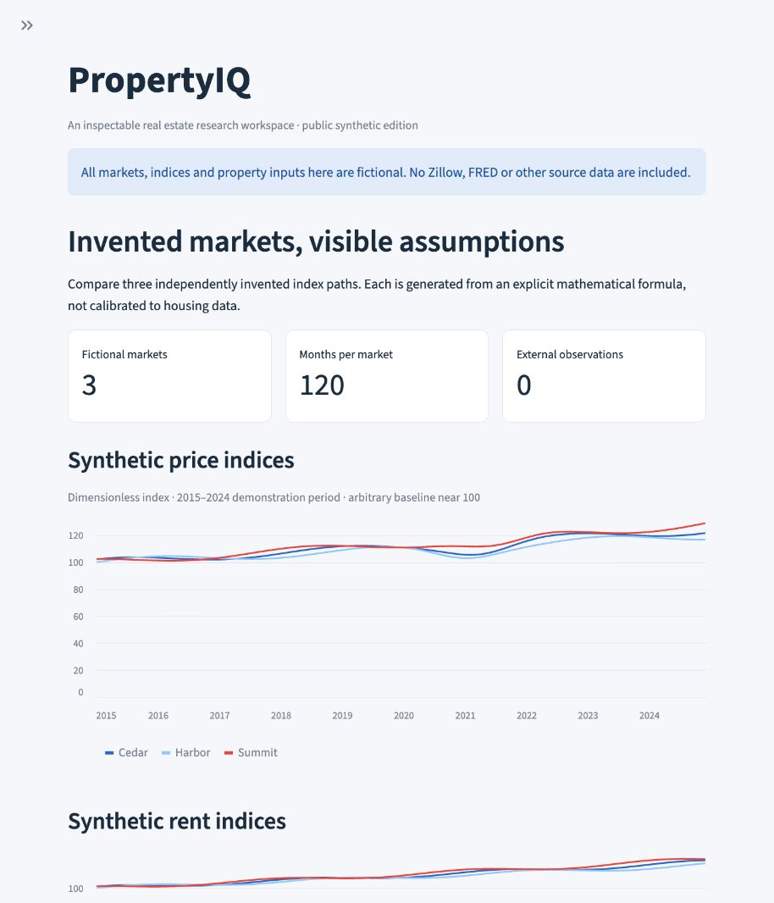
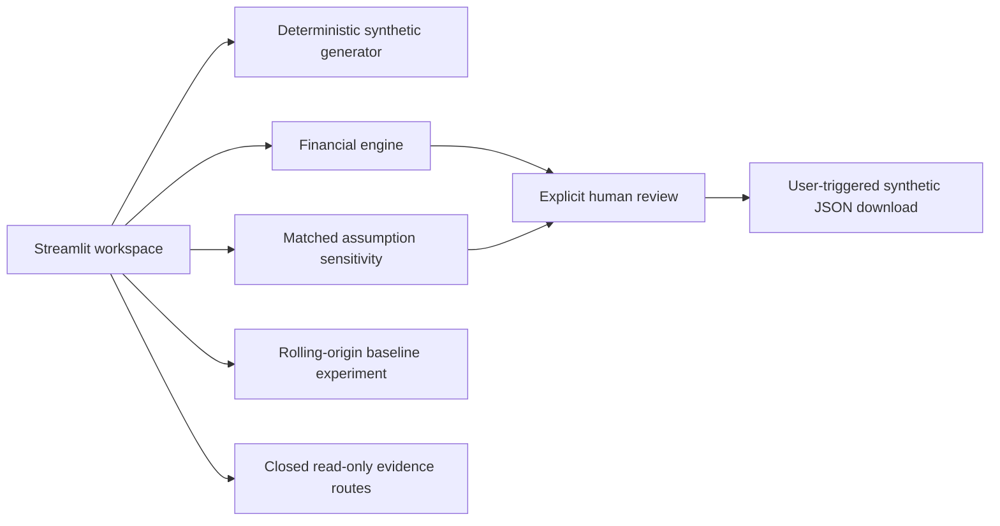
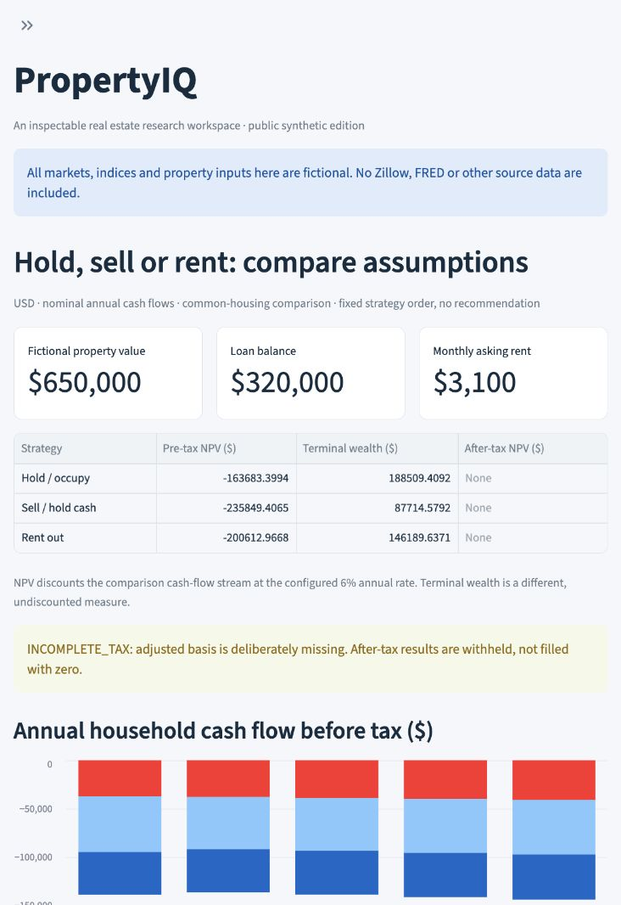

# PropertyIQ

### Real estate analysis you can inspect — with entirely fictional data

A local, offline Streamlit portfolio demo connecting deterministic financial calculations, scenario analysis, rolling-origin forecasting mechanics and human-controlled review.

**Public synthetic edition · no external datasets · no credentials · no LLM inference**



## What you can explore

| Workflow | What it demonstrates |
|---|---|
| Market explorer | Three invented markets, 120 invented monthly observations each, with generator provenance |
| Financial comparison | Hold/occupy, sell/hold cash and rent-out cash flows, financing, NPV and illustrative tax completeness |
| Scenario lab | Matched appreciation sensitivity with other assumptions held constant; no assigned probabilities |
| Forecast lab | Three simple baselines, expanding-window rolling origins and 3/6/9/12-month horizons |
| Evidence explorer | Six fixed, deterministic read-only queries; no model-generated arithmetic or free-form chat |
| Human review | No preselected strategy; an explicit human choice creates a session-only synthetic review export |

The public edition reuses a small allowlist of the project's financial and scenario source modules. It does **not** ship the private research warehouse, real observations, trained model artifacts, 16-tool research agent, prospective registry, OAuth adapters or experimental native credential helper.

## Quick start

Use **Python 3.14** for the independently tested environment. This release was verified on macOS arm64; other platforms and Python versions are not independently certified here. No Apple signing tools are needed.

```sh
python3.14 -m venv .venv
source .venv/bin/activate
python -m pip install -r requirements-lock.txt
python -m pip check
python -B -m unittest discover -s tests -q
python -m streamlit run app/streamlit_app.py
```

Open the loopback address printed by Streamlit, normally `http://127.0.0.1:8501`. Use another port if needed:

```sh
python -m streamlit run app/streamlit_app.py --server.port 8502
```

Windows activation is `.venv\Scripts\activate`. `requirements.txt` declares direct dependencies; `requirements-lock.txt` records the exact tested transitive resolution. Package installation needs access to PyPI. **After installation the demo requires no data download, account, key, database or provider service.** Offline operation describes the application, not initial dependency installation.

## Architecture



No acquisition, database, OAuth, Keychain or provider transport code is imported by the public application. Review state stays in the browser's Streamlit session; the application does not create a reviewer database or attest a person's identity. Changing financial inputs clears an earlier demonstration choice.



## Reproducibility and validation

The portable financial tests use hand-derived and Decimal reference cases. New tests check generated calendars, forecast origin/target separation, error arithmetic, withheld tax outputs, evidence boundaries and explicit reviewer control. Streamlit AppTest exercises all six workflows and important state changes.

**The public suite has its own independently measured result in [Verification](docs/VERIFICATION.md). The private research edition's historical 852-test result is not a public-edition claim.** No excluded data or execution receipt is required to run these tests.

- [Methods and limitations](docs/METHODS.md)
- [Synthetic data provenance](docs/SYNTHETIC_PROVENANCE.json)
- [Copied source provenance](docs/ORIGIN_MANIFEST.json)
- [Portable test scope](docs/TEST_SCOPE.md)
- [Included files](INCLUDED_FILES.json) / [excluded original candidates](EXCLUDED_FILES.json)
- [Dependency inventory](docs/DEPENDENCY_INVENTORY.json) / [third-party notices](THIRD_PARTY_NOTICES.md)

## Data and attribution

All displayed observations and financial examples are fictional. The market generator uses explicit mathematical formulas and is not estimated, calibrated, sampled or transformed from Zillow, FRED, Freddie Mac or another external dataset. Retained geographic codes in the financial schema are compatibility identifiers, not measured metro data. The demo does not use third-party logos or imply endorsement.

The original research project's source-data rights were unresolved for public redistribution. Those files, numeric research reports, screenshots and derivative artifacts are intentionally absent. Attribution would not by itself authorize their redistribution. See [Data policy](docs/DATA_POLICY.md).

## Important limitations

- Educational engineering demonstration, **not** an appraisal, personalized investment recommendation, tax filing calculation or legal advice.
- Synthetic forecast scores demonstrate evaluation mechanics, not real-world predictive accuracy, strict point-in-time validity or future returns. No calibrated prediction intervals or causal claims are made.
- Financial outcomes depend on explicit fictional assumptions. NPV and terminal wealth measure different things; strategies remain in fixed order and are not ranked.
- After-tax results are withheld when adjusted basis is missing. Enabling complete fictional tax inputs does not implement jurisdiction-specific tax law.
- No real ChatGPT sign-in, subscription inference, Keychain integration, production identity verification or live AI capability is provided. There is no developer-funded fallback.
- Do not enter personal records. The UI deliberately has no free-form property upload or credential entry.

## License — scoped MIT project contribution

Copyright (c) 2026 Mi-Qin (Tina) Chen.

The [MIT License](LICENSE) is active **only for the project's own contribution in the exact 40 approved paths** listed as `approved_scope_paths` in the [rights matrix](docs/PROVENANCE_RIGHTS_MATRIX.json). The author explicitly confirmed this scope; see [License review](docs/LICENSE_REVIEW.md) and [Author declaration](docs/AUTHOR_RIGHTS_DECLARATION.md).

This does not relicense third-party dependencies, the 55 legal texts under `docs/licenses/`, upstream dependency metadata, external datasets or derivatives, trademarks, third-party documentation/images, or framework-owned screenshot elements. Those remain under their own terms. No third-party dataset is included. The root LICENSE is the standard license instrument, not an additional project contribution. The earlier proposal has been superseded and removed.

Do not upload local `.git` metadata, environments, external verification records or ignored files as a release archive. License activation does not authorize GitHub publication.
